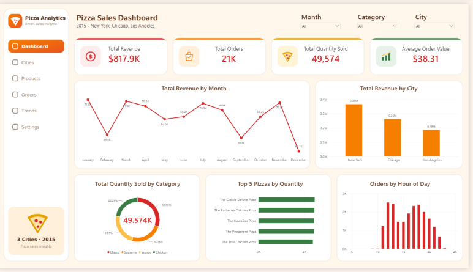

# 🍕 Pizza Sales Analytics: Multi-City Dashboard

An end-to-end data analytics project that takes raw pizza order data through **Excel → SQL → Power BI**: organizing and cleaning the data, aggregating it with SQL, and presenting the results in an interactive Power BI dashboard.



---

## 📌 Project Overview

A pizza restaurant chain wants to understand its sales performance across multiple cities. This project answers questions such as:

- How much revenue and how many orders did we generate, and what is the average order value?
- Which cities generate the most revenue?
- Which pizza categories and individual pizzas sell the most?
- How does revenue change month by month?
- At what hours of the day are orders concentrated?

## 🛠️ Tools & How Each Was Used

| Tool | Role in the project |
|---|---|
| **Microsoft Excel** | Organizing the data and quick cleaning: inspecting columns, checking for duplicates and missing values, and preparing the dataset for analysis |
| **SQL (MySQL)** | Building the relational tables and writing analytical queries with **aggregate functions** (`SUM`, `COUNT`, `AVG`, `GROUP BY`, `JOIN`, `ORDER BY`) |
| **Power BI** | Data modeling (star schema), DAX measures, charts, and the final interactive dashboard |

## 📂 Dataset

- **Source:** [Pizza Sales Dataset on Kaggle](https://www.kaggle.com/datasets/nextmillionaire/pizza-sales-dataset)
- **Size:** 48,620 order lines, 21,350 orders, one year of sales (2015)
- **Fields:** order ID, date, time, pizza name, category, size, ingredients, quantity, unit price, total price

> **⚠️ Note on cities:** the original dataset covers a single restaurant and has **no city or branch column**. To simulate a multi-city business, I added a `branches` table (New York, Chicago, Los Angeles) and assigned each order to one branch with an uneven, realistic split. City-level results are therefore **simulated** and meant to demonstrate the analysis workflow, not real-world city performance.

## 🧹 Data Preparation

Issues found and handled before analysis:

- **Mixed date formats:** some dates were `M/D/YYYY` and others `D-M-YYYY`; they were standardized into a single date type.
- Checked for **null values and duplicate rows** (none found).
- Converted text columns to proper data types (dates, times, decimals).
- Split the flat file into normalized tables and added the branch dimension.

## 🗄️ SQL: Database & Analysis

The data is stored in five related tables:

```
branches (branch_id, city, branch_name)
pizza_types (pizza_type_id, name, category, ingredients)
pizzas (pizza_name_id, pizza_type_id, size, price)
orders (order_id, order_date, order_time, branch_id)
order_details (order_details_id, order_id, pizza_name_id, quantity)
```

Example: revenue, orders, and average order value per city

```sql
SELECT
    b.city,
    COUNT(DISTINCT o.order_id) AS total_orders,
    ROUND(SUM(od.quantity * p.price), 2) AS total_revenue,
    ROUND(SUM(od.quantity * p.price) / COUNT(DISTINCT o.order_id), 2) AS avg_order_value
FROM orders o
JOIN branches b       ON o.branch_id = b.branch_id
JOIN order_details od ON o.order_id = od.order_id
JOIN pizzas p         ON od.pizza_name_id = p.pizza_name_id
GROUP BY b.city
ORDER BY total_revenue DESC;
```

More queries (top-selling pizzas, monthly revenue per city, category mix by city) are in [`sql/sample_queries.sql`](sql/sample_queries.sql).

## 📊 Power BI: Model & Dashboard

**Data model: star schema**

- **Fact table:** `Fact_Sales`
- **Dimensions:** `Dim_Branch`, `Dim_Pizza`, `Dim_Date`
- Relationships: Many-to-One, single-direction filtering from each dimension to the fact table
- A hidden staging query keeps the fact and dimension queries independent in Power Query

**Key DAX measures**

```dax
Total Revenue = SUM(Fact_Sales[total_price])
Total Orders = DISTINCTCOUNT(Fact_Sales[order_id])
Total Quantity Sold = SUM(Fact_Sales[quantity])
Average Order Value = DIVIDE([Total Revenue], [Total Orders])
```

**Dashboard contents**

- KPI cards: Total Revenue, Total Orders, Total Quantity Sold, Average Order Value
- Revenue by month (line chart) and by city (column chart)
- Quantity sold by category (donut) and Top 5 pizzas (bar)
- Orders by hour of the day (column chart)
- Slicers: Month, Category, City
- Custom theme and background designed for a clean, modern look

## 🔎 Key Takeaways

- Overall: about **$817.9K** in revenue from **21,350 orders**, with an average order value of about **$38.31**.
- **Classic** is the best-selling category by quantity.
- Orders peak around **lunch (12–13h)** and **early evening (17–19h)**.
- Sales across the top pizzas are very close, so no single product dominates.

## 📁 Repository Structure

```
├── data/
│   └── pizza_sales_clean.csv
├── sql/
│   ├── pizza_sales_db_full.sql      # create tables + insert data
│   └── sample_queries.sql           # analytical queries
├── powerbi/
│   ├── Pizza_Sales_Dashboard.pbix
│   ├── pizza_theme.json
│   └── dashboard_background.png
├── images/
│   └── dashboard.png
└── README.md
```

## ▶️ How to Reproduce

1. **SQL:** open `sql/pizza_sales_db_full.sql` in MySQL Workbench and run it to create the `pizza_sales_db` database with all tables and data.
2. **Queries:** run `sql/sample_queries.sql` to see the aggregated results.
3. **Power BI:** open `Pizza_Sales_Dashboard.pbix` in Power BI Desktop. To apply the visual style on a new report, import `pizza_theme.json` (View → Themes → Browse for themes) and set `dashboard_background.png` as the page background.

## 💡 Skills Demonstrated

Data cleaning and validation · Relational database design · SQL aggregation and joins · Star-schema data modeling · DAX measures · Dashboard design and storytelling

## 👤 Author

Khadija AL- Dosari
[LinkedIn](https://www.linkedin.com/in/khadija-al-dosari-4447b5221) · [GitHub](https://github.com/ghkhadija1995-dot)